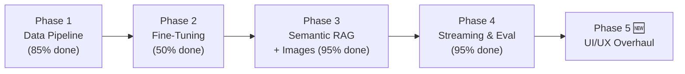

# 🚀 Presidency University OIA Chatbot — Full Upgrade Plan (Revised)

> [!IMPORTANT]
> This is the **revised plan** updated to reflect actual implementation status as of October 2026.
> ✅ = Already implemented · ⚠️ = Partially done · ❌ = Not yet done · 🆕 = New addition

---

## 🗺️ Phase Overview



---

## Phase 1 — Data Ingestion & Web Scraping

> **Goal:** Build a rich, multi-source knowledge corpus from the university website, PDFs, and local photos. This feeds both fine-tuning (Phase 2) and the RAG pipeline (Phase 3).

### 1A — Scrape the International Collaborations Page ✅ Done

[`scraper.py`](file:///c:/Users/meerm/Desktop/M3AR-OIA_Bot-main/scraper.py) is implemented with:
- `requests` + `BeautifulSoup` HTML cleaning
- Hardcoded `VERIFIED_PARTNERS` fallback (165+ institutions, 30+ countries) as insurance against scrape failures
- `format_comprehensive_collaborations()` for structured output

**Output:** `scraped_data/collaborations.txt` ✅ exists

> [!WARNING]
> **Known issue:** The live scrape currently captures some navigation noise (`"Academics Student AffairsHomeClubs…"`). The hardcoded partner data saves the day, but improve the HTML filter by targeting the main content `<div>` more precisely or adding a minimum line-length filter (skip lines < 20 chars).

**Fix to apply in `scraper.py`:**
```python
# In clean_html(), replace the lines filter with:
lines = []
for tag in soup.find_all(["h1", "h2", "h3", "h4", "p", "li"]):
    text = tag.get_text(strip=True)
    if text and len(text) > 20:   # ← raise threshold from 2 to 20
        if text.lower() not in ["home", "menu", "contact us", "apply now", "read more", "click here"]:
            lines.append(text)
```

**Dependencies (already in `requirements.txt`):**
```
requests>=2.31.0
beautifulsoup4>=4.12.0
```

---

### 1B — PDF Ingestion Pipeline ✅ Done

[`pdf_ingester.py`](file:///c:/Users/meerm/Desktop/M3AR-OIA_Bot-main/pdf_ingester.py) is implemented. Reads PDFs from `data/pdfs/`, writes extracted text to `scraped_data/`. Adds `[Page N]` markers per page.

- `data/pdfs/international_student_handbook.pdf` ✅ present
- `scraped_data/international_student_handbook.txt` ✅ extracted

**Dependency (already in `requirements.txt`):**
```
pdfplumber>=0.10.0
```

---

### 1C — Image Metadata Tagging ✅ Done (Enhanced)

[`Photos/image_manifest.json`](file:///c:/Users/meerm/Desktop/M3AR-OIA_Bot-main/Photos/image_manifest.json) is complete for all 7 images (5 original + 2 bonus):

| File | Title |
|---|---|
| `1.jpeg` | Office of International Affairs - Main Entrance |
| `2.jpeg` | International Student Visitor Lounge & Reception |
| `3.jpeg` | Taiwan Education Center (TECC) Plaque & Collaboration |
| `4.jpeg` | Global Partner Universities & Collaborations Wall |
| `5.jpeg` | OIA Counseling & International Advisory Cabins |
| `campus_banner_2.jpeg` | Campus Banner (bonus) |
| `presidency_campus_bg.jpeg` | Background image used in UI |

Each entry has `title`, `tags`, `description`, and `topics` for weighted scoring in `image_matcher.py`.

---

## Phase 2 — Fine-Tuning the Model on University Data

> **Goal:** Teach Qwen2.5-0.5B the university's domain language, facts, partner names, and tone.

> [!WARNING]
> Fine-tuning requires at least **8 GB RAM** and ideally a GPU with 6+ GB VRAM. Use **Google Colab (free T4)** or **Kaggle Notebooks**. On CPU it will be extremely slow.

### 2A — Build the Fine-Tuning Dataset ⚠️ Needs Re-Run

[`dataset_builder.py`](file:///c:/Users/meerm/Desktop/M3AR-OIA_Bot-main/dataset_builder.py) is implemented and enhanced beyond the original plan:
- `build_qa_from_knowledge()` — category-aware question variants per knowledge entry
- `build_qa_from_text()` — chunk-level pairs from scraped/PDF text

**Problem:** `data/finetune_dataset.jsonl` currently has only **21 lines** — the builder was run before the scraper/PDF data was populated.

**Fix — always run in this exact order:**
```bash
python pdf_ingester.py      # 1. Extract PDFs → scraped_data/
python scraper.py           # 2. Refresh scraped_data/collaborations.txt
python dataset_builder.py   # 3. Rebuild the JSONL from all sources
```

Expected output after re-run: **200–500+ training pairs**.

> [!NOTE]
> The dataset builder uses `prompt`/`completion` keys instead of the plan's `messages` list format. This works with `SFTTrainer` when using `formatting_func`. The Colab notebook handles this correctly.

---

### 2B — Fine-Tune with QLoRA ⚠️ Not Run Yet

The standalone `finetune.py` from the original plan has been **replaced by `finetune_colab.ipynb`** — a full-featured Google Colab notebook using QLoRA (4-bit NF4 quantization + LoRA rank 16).

**Why the notebook is better:**
- Runs on free Colab T4 GPU (no local GPU needed)
- Includes GPU sanity check, progressive training logs, and adapter saving
- Self-contained — upload `data/finetune_dataset.jsonl` and run all cells

**LoRA config (same as plan):**
```python
LoraConfig(r=16, lora_alpha=32, target_modules=["q_proj", "v_proj"],
           lora_dropout=0.05, bias="none", task_type="CAUSAL_LM")
```

**Steps:**
1. Run the data pipeline above (2A)
2. Upload `data/finetune_dataset.jsonl` to Colab
3. Run all cells in `finetune_colab.ipynb`
4. Download the resulting `fine_tuned_model/` folder

**New dependencies (already in `requirements.txt`):**
```
peft>=0.10.0
trl>=0.8.0
datasets>=2.18.0
accelerate>=0.29.0
bitsandbytes>=0.43.0
```

---

### 2C — Switch Bot Engine to Fine-Tuned Model ❌ Pending Training

After downloading the fine-tuned weights from Colab, update one line in [`bot_engine.py`](file:///c:/Users/meerm/Desktop/M3AR-OIA_Bot-main/bot_engine.py#L27):

```python
# Change this in bot_engine.py:
MODEL_ID = "./fine_tuned_model"   # swap from "Qwen/Qwen2.5-0.5B-Instruct"
```

Place the downloaded `fine_tuned_model/` folder in the project root.

---

## Phase 3 — Semantic RAG + Image-Aware Responses ✅ Fully Implemented

> **Goal:** Dense semantic search over the full knowledge corpus, with automatic image attachments.

### 3A — Semantic Retrieval ✅ Done (Enhanced)

[`semantic_retriever.py`](file:///c:/Users/meerm/Desktop/M3AR-OIA_Bot-main/semantic_retriever.py) — full multi-source FAISS retriever with 3-tier fallback:

1. **FAISS `IndexFlatIP`** — cosine similarity via normalized embeddings (better than the plan's `IndexFlatL2`)
2. **NumPy cosine similarity** — if FAISS unavailable
3. **Keyword scoring** — final fallback if `sentence-transformers` not installed

Corpus sources:
- `knowledge.py` → `KNOWLEDGE_ENTRIES` (8 structured entries)
- `scraped_data/*.txt` → chunked by `\n\n` paragraphs, min 80 chars

> [!NOTE]
> The plan specified `data/chunks.json` as the corpus file. The actual implementation builds the index **in-memory** at startup — equivalent behavior, no file needed.

**Dependencies (already in `requirements.txt`):**
```
sentence-transformers>=2.7.0
faiss-cpu>=1.8.0
```

---

### 3B — Image-Aware Response System ✅ Done (Enhanced)

[`image_matcher.py`](file:///c:/Users/meerm/Desktop/M3AR-OIA_Bot-main/image_matcher.py) — keyword scoring with weights:

| Match type | Score |
|---|---|
| Topic keyword match | +4 |
| Tag keyword match | +3 |
| Title keyword match | +2 |
| Description match | +1 |

Returns top 2 matching image paths. All images verified to exist on disk before scoring.

---

### 3C — Images Wired into the Bot ✅ Done (Differently)

Rather than returning `gr.Image()` objects as the plan specified, images are embedded as **inline Base64 Markdown** in [`bot_engine.py`](file:///c:/Users/meerm/Desktop/M3AR-OIA_Bot-main/bot_engine.py#L47-L65):

```python
f"\n\n**📸 {title}**\n\n\n"
```

**Why this is better:** Works reliably in Gradio 5.x without needing `gr.Image()` return types, renders correctly both in streaming mode and sync mode, and survives Gradio version upgrades.

---

## Phase 4 — Streaming, Quantization & Evaluation ✅ Fully Implemented

### 4A — Token Streaming ✅ Done

[`generate_response_streaming()`](file:///c:/Users/meerm/Desktop/M3AR-OIA_Bot-main/bot_engine.py#L223) uses `TextIteratorStreamer` + `Thread` exactly as planned. Images are appended as a final Base64 block after all tokens stream.

[`app.py`](file:///c:/Users/meerm/Desktop/M3AR-OIA_Bot-main/app.py#L24-L36) calls it via `chat_stream_fn()` with fixed `temperature=0.3`, `max_new_tokens=250`.

### 4B — 4-bit Quantization ✅ Done

`BitsAndBytesConfig` (NF4) is implemented in `bot_engine.py` with `use_quantization=False` as default (safe for CPU). Enable on GPU:

```python
bot = InternationalOfficeBot(use_quantization=True)  # in app.py
```

### 4C — Evaluation Suite ✅ Done (Enhanced)

[`evaluate.py`](file:///c:/Users/meerm/Desktop/M3AR-OIA_Bot-main/evaluate.py) — 10 benchmark scenarios (plan had 2 examples), covering:
FRRO compliance · Scholarships · Visa · Admissions · Fees · Accommodation · ICCR · Study In India · Health Insurance · Office Contact

**Smarter pass logic:** `≥70%` keyword hit rate (not 100% all-or-nothing as the plan specified). Includes per-query timing and a final accuracy percentage.

```bash
python evaluate.py   # exits 0 if ≥8/10 pass
```

---

## Phase 5 🆕 — UI/UX Overhaul

> **Goal:** Elevate the chatbot from a functional tool to a polished, user-friendly international student portal experience.

### 5A — Typing Indicator & Response Metadata

Show a subtle "Counselor is typing…" state and append response time + source badges after each answer.

```python
# In app.py — wrap chat_stream_fn to prefix a typing hint:
def chat_stream_fn(message, history):
    if not message or not str(message).strip():
        yield ""
        return
    yield "⏳ *AI Counselor is preparing your response…*"
    accumulated = ""
    for partial in bot.generate_response_streaming(
        user_message=str(message), history=history,
        temperature=0.3, max_new_tokens=250
    ):
        accumulated = partial
        yield accumulated
    # Append source badge
    yield accumulated + "\n\n---\n*🔍 Powered by FAISS Semantic RAG · Qwen2.5-0.5B · Presidency OIA Knowledge Base*"
```

---

### 5B — Suggested Follow-Up Questions

After each answer, dynamically surface 3 contextually-relevant follow-up chips.

```python
# New file: followup_suggester.py
FOLLOWUP_MAP = {
    "visa":         ["What is the 14-day FRRO rule?", "What documents does the university issue for my visa?", "Can I convert a tourist visa to a student visa?"],
    "frro":         ["How do I register on the e-FRRO portal?", "What is Form C and who issues it?", "What happens if I miss the 14-day window?"],
    "scholarship":  ["What is the ICCR scholarship?", "How do I apply for the Study In India program?", "Is there a university merit scholarship?"],
    "hostel":       ["What room types are available?", "Is food included in the hostel fee?", "How do I get Form C from the hostel?"],
    "admission":    ["What is an AIU Equivalence Certificate?", "How long does the admission process take?", "What is a Provisional Admission Letter (PAL)?"],
    "fees":         ["Can I pay tuition in USD?", "What is the SWIFT transfer process?", "Where do I send my wire transfer receipt?"],
    "collaborations": ["Which German universities are partnered?", "Is there a Taiwan Education Center on campus?", "How do I apply for a student exchange program?"],
}

def get_followups(bot_response: str, user_query: str) -> list[str]:
    combined = (bot_response + " " + user_query).lower()
    for key, suggestions in FOLLOWUP_MAP.items():
        if key in combined:
            return suggestions[:3]
    return [
        "What documents do I need for admission?",
        "What scholarships are available?",
        "Where is the Office of International Affairs?"
    ]
```

Wire into `app.py` using Gradio's `gr.Dataset` or clickable `gr.Button` rows below the chatbot.

---

### 5C — Dark/Light Mode Toggle

Add a theme toggle button to the header. Gradio 5.x supports `gr.themes.Base` with CSS variable overrides.

```python
# In app.py — add a toggle button in the header block:
with gr.Row():
    theme_toggle = gr.Button("🌙 Dark Mode", size="sm", elem_id="theme-toggle")

# CSS for dark mode class on .gradio-container:
dark_mode_css = """
.dark-mode, .dark-mode .gradio-container {
    background-color: #0d1117 !important;
    color: #e6edf3 !important;
}
.dark-mode .chatbot { background: rgba(22, 27, 34, 0.97) !important; }
"""

# JS toggle (inject via gr.HTML):
toggle_js = """
<script>
document.getElementById('theme-toggle')?.addEventListener('click', function() {
    document.body.classList.toggle('dark-mode');
    this.textContent = document.body.classList.contains('dark-mode') ? '☀️ Light Mode' : '🌙 Dark Mode';
});
</script>
"""
```

---

### 5D — Structured Welcome Card & Quick-Action Tiles

Replace the plain text placeholder with a rich welcome card showing quick-action tiles the user can click.

```python
WELCOME_HTML = """
<div style="padding:16px; background:linear-gradient(135deg,#0b2545,#134074); border-radius:12px; color:white; margin-bottom:8px;">
  <h3 style="margin:0 0 12px;">👋 Welcome! How can I help you today?</h3>
  <div style="display:grid; grid-template-columns:1fr 1fr; gap:8px;">
    <div class="quick-tile" onclick="fillQuery('How do I apply as an international student?')">📋 Admission Process</div>
    <div class="quick-tile" onclick="fillQuery('What visa do I need to study in India?')">🛂 Student Visa Guide</div>
    <div class="quick-tile" onclick="fillQuery('What scholarships are available for foreign students?')">🎓 Scholarships</div>
    <div class="quick-tile" onclick="fillQuery('Tell me about international university collaborations')">🌍 Global Partners</div>
    <div class="quick-tile" onclick="fillQuery('What hostel and accommodation options are there?')">🏠 Accommodation</div>
    <div class="quick-tile" onclick="fillQuery('Where is the Office of International Affairs?')">📍 Contact & Location</div>
  </div>
</div>
<style>
  .quick-tile {
    background: rgba(255,255,255,0.12); border:1px solid rgba(255,255,255,0.2);
    border-radius:8px; padding:10px 12px; cursor:pointer; font-size:13px;
    font-weight:500; transition:all 0.2s ease; text-align:center;
  }
  .quick-tile:hover { background:rgba(255,255,255,0.22); transform:translateY(-2px); }
</style>
<script>
function fillQuery(text) {
  const box = document.querySelector('textarea');
  if (box) { box.value = text; box.dispatchEvent(new Event('input', {bubbles:true})); }
}
</script>
"""
```

Replace the current `chatbot=gr.Chatbot(placeholder=...)` with `gr.HTML(WELCOME_HTML)` above the `ChatInterface`.

---

### 5E — Mobile-Responsive Layout Improvements

The current layout uses a fixed `max-width: 1050px`. Add responsive breakpoints and improve touch targets for mobile visitors.

```css
/* Add to custom_css in app.py */

/* Mobile: stack layout, larger touch targets */
@media (max-width: 768px) {
    .gradio-container { max-width: 100% !important; padding: 8px !important; }
    .header-box h1 { font-size: 20px !important; }
    .header-box p { font-size: 13px !important; }
    .badge { font-size: 9px !important; padding: 3px 8px !important; }
    .examples button { padding: 10px !important; font-size: 12px !important; }
    /* Larger tap target for send button */
    button[aria-label="Ask Counselor"] { min-height: 48px !important; }
}

/* Tablet */
@media (max-width: 1024px) {
    .gradio-container { max-width: 96% !important; }
}
```

---

### 5F — Feedback Thumbs (👍 / 👎) per Response

Add lightweight inline feedback to track answer quality without a backend.

```python
# Append to each bot response in chat_stream_fn:
feedback_html = (
    "\n\n<sub>Was this helpful? "
    "<a href='#' onclick='logFeedback(\"up\")'>👍</a> · "
    "<a href='#' onclick='logFeedback(\"down\")'>👎</a></sub>"
)

# JS logger (can be swapped to a real API call later):
feedback_js = """
<script>
function logFeedback(val) {
  console.log('Feedback:', val, new Date().toISOString());
  // TODO: POST to /feedback endpoint
}
</script>
"""
```

---

## 📁 Final Project Structure (After All Phases)

```
M3AR-OIA_Bot-main/
│
├── data/
│   ├── pdfs/
│   │   └── international_student_handbook.pdf  ✅
│   └── finetune_dataset.jsonl                  ⚠️ needs re-run
│
├── scraped_data/
│   ├── collaborations.txt                       ✅
│   └── international_student_handbook.txt       ✅
│
├── Photos/
│   ├── 1.jpeg … 5.jpeg                          ✅
│   ├── campus_banner_2.jpeg                     ✅ bonus
│   ├── presidency_campus_bg.jpeg                ✅ bonus
│   └── image_manifest.json                      ✅
│
├── fine_tuned_model/                            ❌ run Colab notebook
│
├── app.py                  ✅ streaming UI (Phase 5 updates pending)
├── bot_engine.py           ✅ streaming + quantization
├── retriever.py            ✅ legacy keyword fallback
├── semantic_retriever.py   ✅ FAISS + SentenceTransformer
├── image_matcher.py        ✅ weighted image scoring
├── scraper.py              ✅ (fix nav noise filter)
├── pdf_ingester.py         ✅
├── dataset_builder.py      ✅ (re-run after data refresh)
├── finetune_colab.ipynb    ✅ replaces planned finetune.py
├── evaluate.py             ✅ 10-test benchmark suite
├── followup_suggester.py   ❌ Phase 5B (new file)
├── knowledge.py            ✅
├── cli_chat.py             ✅
├── requirements.txt        ✅
└── README.md               ✅
```

---

## 📦 Full Updated `requirements.txt`

```
# Core LLM
transformers>=4.40.0
torch>=2.0.0

# Fine-tuning
peft>=0.10.0
trl>=0.8.0
datasets>=2.18.0
accelerate>=0.29.0
bitsandbytes>=0.43.0   # 4-bit QLoRA; Linux/GPU only

# Semantic RAG
sentence-transformers>=2.7.0
faiss-cpu>=1.8.0

# Data ingestion
requests>=2.31.0
beautifulsoup4>=4.12.0
pdfplumber>=0.10.0

# UI
gradio>=5.0.0
```

---

## 🗓️ Revised Execution Order & Time Estimates

| Step | Task | Status | Est. Time |
|---|---|---|---|
| **1A** | Fix scraper nav-noise filter | ⚠️ Quick fix | 15 min |
| **1B** | Drop more PDFs, re-run `pdf_ingester.py` | ✅ Done | — |
| **1C** | Image manifest complete | ✅ Done | — |
| **2A** | Re-run data pipeline in order | ⚠️ Must do | 15 min |
| **2B** | Run `finetune_colab.ipynb` on Colab T4 | ❌ Pending | 1–3 hrs (GPU) |
| **2C** | Swap `MODEL_ID` to `./fine_tuned_model` | ❌ After 2B | 5 min |
| **3A–3C** | Semantic RAG + images | ✅ Done | — |
| **4A–4C** | Streaming + quantization + eval | ✅ Done | — |
| **5A** | Typing indicator + source badge | ❌ New | 30 min |
| **5B** | Follow-up question chips | ❌ New | 1 hr |
| **5C** | Dark/light mode toggle | ❌ New | 1 hr |
| **5D** | Welcome card + quick-action tiles | ❌ New | 1 hr |
| **5E** | Mobile-responsive CSS | ❌ New | 45 min |
| **5F** | Feedback thumbs per response | ❌ New | 30 min |

**Remaining effort: ~8–10 hours (fine-tuning on Colab + Phase 5 UI work)**

---

> [!TIP]
> **Recommended next steps in order:**
> 1. Fix the scraper filter (15 min) → re-run the data pipeline → verify `finetune_dataset.jsonl` has 200+ lines
> 2. Run `finetune_colab.ipynb` on Google Colab, download weights, swap `MODEL_ID`
> 3. Implement Phase 5 UI changes top-to-bottom — each sub-task is independent and shippable on its own
